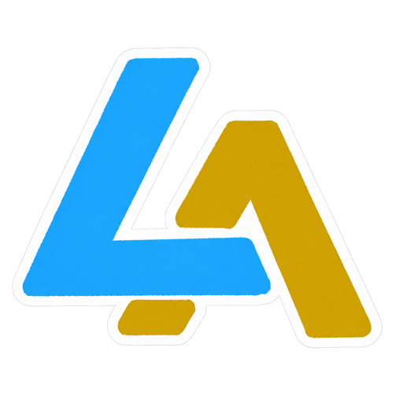
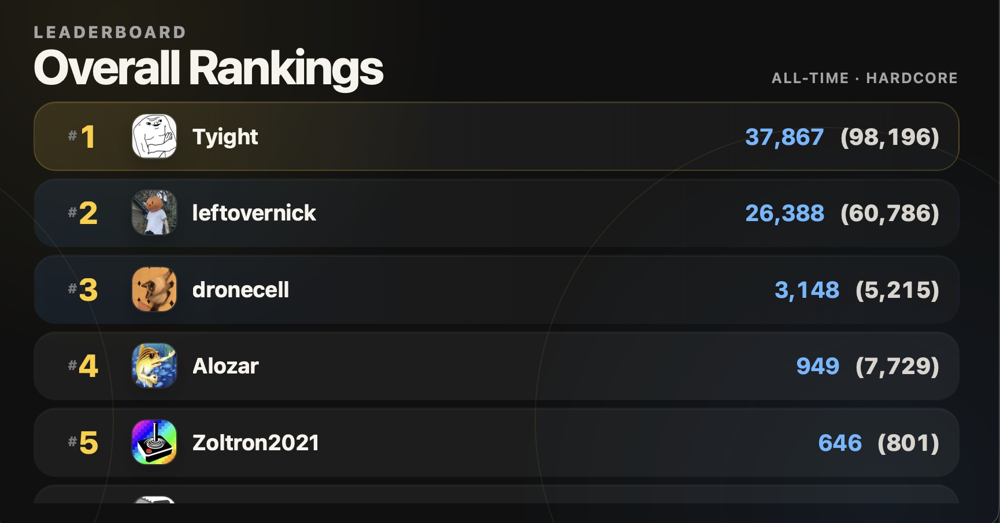
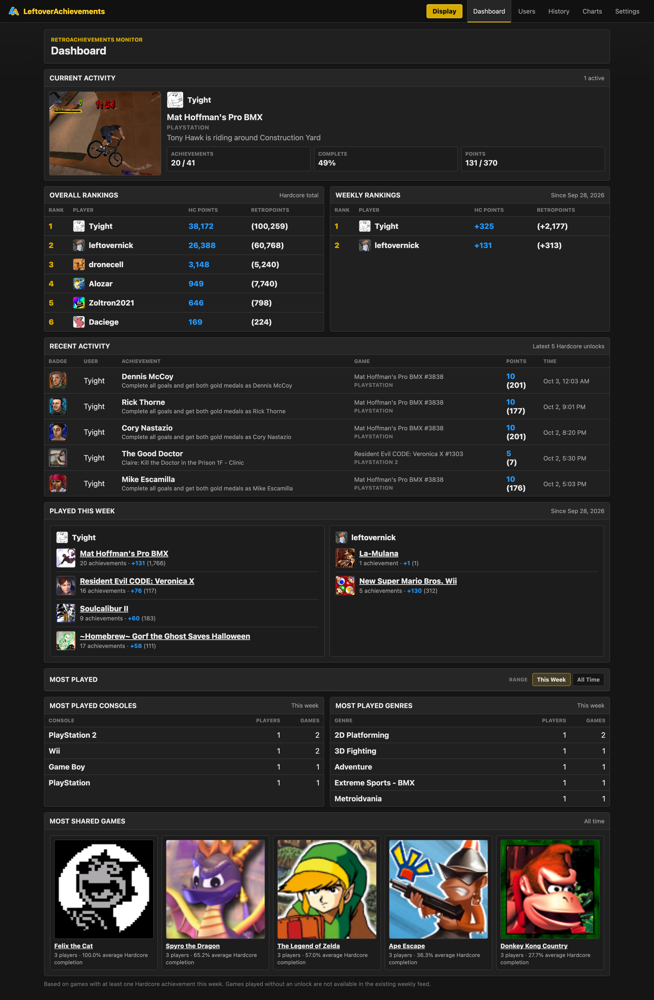
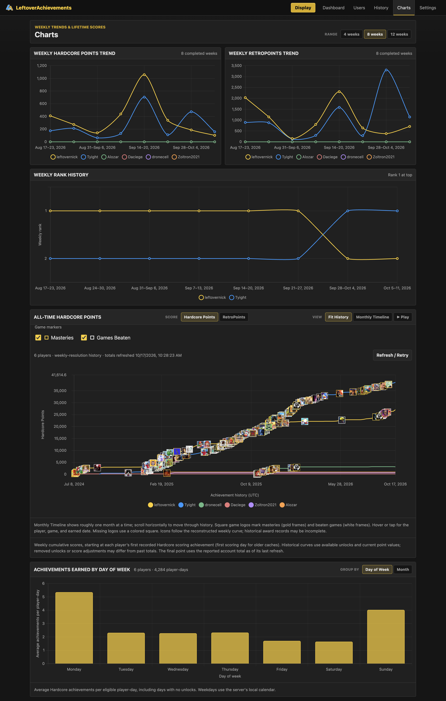
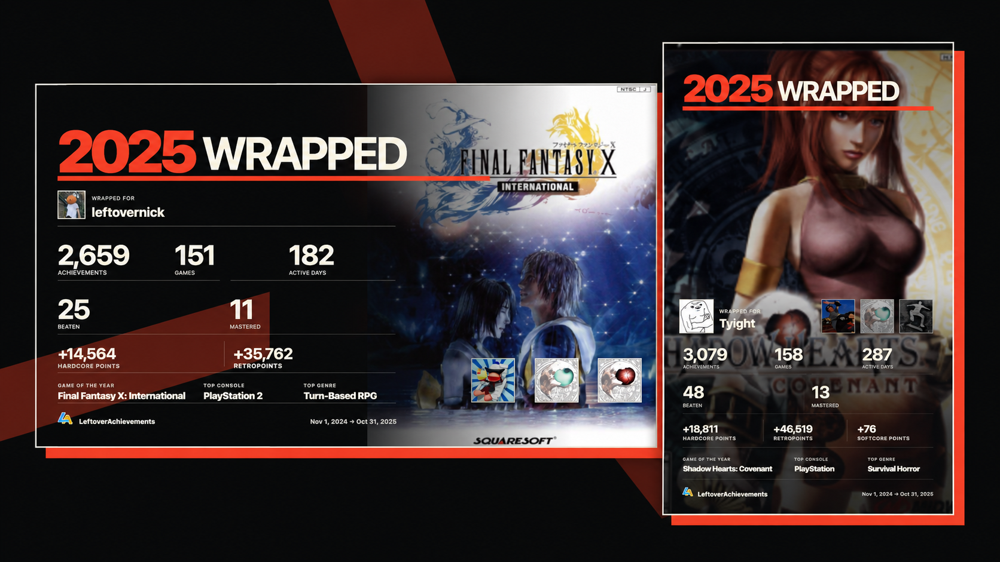

<p align="center">
  
</p>

<h1 align="center">LeftoverAchievements</h1>

<h3 align="center">Your games. Your progress. Where you want it.</h3>

<p align="center">
  A dedicated Raspberry Pi secondary display, a complete macOS or Windows app,<br>
  or a connected companion to another installation.
</p>

<p align="center">
  <strong><a href="https://github.com/leftovernick/Leftover-Achievements/releases/latest">Download the latest release</a></strong>
  ·
  <a href="https://leftoverachievements.nickgray.dev/">Visit the website</a>
  ·
  <a href="https://leftoverachievements.nickgray.dev/guide">View the app guide</a>
</p>



## What is LeftoverAchievements?

LeftoverAchievements turns [RetroAchievements](https://retroachievements.org/)
activity into a shared dashboard, leaderboard, history view, live achievement
display, progress charts, and annual Wrapped recap.

It was designed to turn a Raspberry Pi into a dedicated screen beside your gaming
setup. The same complete app also runs independently on macOS and Windows. Any
installation can act as a hub or connect to another installation as a companion.

Everything runs on your own device. Your RetroAchievements Web API key, settings,
and history are stored locally by the hub.

## See everyone's progress in one place

Follow weekly rankings, recent unlocks, current games, beaten games, masteries, and
shared activity across all your tracked players.

<p align="center">
  
</p>

## Follow the long game

Compare recent progress or explore lifetime Hardcore Points and RetroPoints. Follow
rank changes, masteries, beaten games, and activity patterns over time.

<p align="center">
  
</p>

## Revisit your year with Wrapped

Wrapped turns a year of RetroAchievements activity into a visual story and a recap
you can save in horizontal or Stories format. The installed app keeps previous years
alongside your everyday history.



## Download

**[Open the latest release](https://github.com/leftovernick/Leftover-Achievements/releases/latest)**

| Device | Download |
| --- | --- |
| Apple Silicon Mac | `LeftoverAchievements-macOS-arm64.dmg` |
| Intel Mac | `LeftoverAchievements-macOS-x64.dmg` |
| Windows 10/11 x64 | `LeftoverAchievements-Windows-x64-<version>.zip` |
| Raspberry Pi 4/5 | Use the guided installer below |

You will need a RetroAchievements account and a Web API key. You can create or copy
your key from the [RetroAchievements control panel](https://retroachievements.org/controlpanel.php).

## Install on macOS

1. Download the DMG that matches your Mac:
   - Choose **arm64** for an Apple Silicon Mac with an M-series processor.
   - Choose **x64** for an Intel Mac.
2. Open the downloaded DMG.
3. Drag **LeftoverAchievements** into **Applications**.
4. Open LeftoverAchievements from Applications.
5. Select the trophy icon in the menu bar and choose **Open Dashboard**.

The app is not currently notarized. If macOS blocks the first launch, Control-click
**LeftoverAchievements** in Applications, choose **Open**, and confirm. You can also
approve it under **System Settings → Privacy & Security**.

LeftoverAchievements runs in the menu bar without a Dock icon. Closing its browser
or Display window does not stop the app. Use **Quit LeftoverAchievements** from the
trophy menu when you want to stop it.

## Install on Windows

1. Download `LeftoverAchievements-Windows-x64-<version>.zip`.
2. Extract the entire ZIP into a permanent folder.
3. Open that folder and run the LeftoverAchievements executable.
4. Select the trophy icon in the system tray and choose **Open Dashboard**.

Do not run the executable from inside the ZIP; the other extracted files are required.

The native Display window requires the
[Microsoft Edge WebView2 Runtime](https://developer.microsoft.com/microsoft-edge/webview2/).
It is already present on most current Windows 10 and Windows 11 installations. The
dashboard still works in a normal browser if WebView2 is unavailable.

Use **Quit LeftoverAchievements** from the system-tray menu to stop the app.

## Install on Raspberry Pi 4 or 5

Use Raspberry Pi OS 64-bit with Desktop. Before the first boot, use Raspberry Pi
Imager to configure a normal user, networking, and SSH.

After the Pi starts and can reach the internet, open a terminal as the normal user
and download the installer:

```bash
curl -fsSLO https://raw.githubusercontent.com/leftovernick/Leftover-Achievements/main/scripts/bootstrap-pi.sh
```

You can inspect `bootstrap-pi.sh` before running it. Start the installation without
`sudo`:

```bash
bash bootstrap-pi.sh
```

The installer downloads the latest stable Raspberry Pi release, verifies it,
installs the required software, configures the background service and kiosk, checks
the local display, and then begins a ten-second reboot countdown. Press Ctrl+C during
the countdown to cancel the reboot, or install without scheduling one:

```bash
bash bootstrap-pi.sh --no-reboot
```

After the Pi restarts, open the following address from another device on the same
network:

```text
http://<raspberry-pi-hostname>.local:8000/
```

For example, a Pi named `leftover-pi` is available at
`http://leftover-pi.local:8000/`.

The Pi starts directly in the LeftoverAchievements display. Its normal desktop is
hidden while kiosk mode is enabled, but SSH remains available.

## First-time setup

The setup guide opens automatically on a new installation.

1. Choose **Set Up This Device** to make this installation a hub, or choose
   **Connect to an existing hub** if another device already owns your data.
2. Paste your RetroAchievements Web API key. The app verifies it before saving it.
3. Add the RetroAchievements usernames you want to track.
4. Preview the shared display.
5. Finish setup and open the dashboard or display.

The API key is stored locally and is never shown again in the browser. Initial
account history can take several minutes to load for long-running accounts. Follow
its progress under **Charts → All Time** or **Settings → History Data**.

## Using the app

- **Display** keeps scores, current games, and live achievement alerts in view.
- **Dashboard** shows weekly rankings, recent unlocks, and shared activity.
- **Users** manages tracked players and each player's alert preferences.
- **History** returns to completed weeks and available Wrapped recaps.
- **Charts** compares weekly and lifetime progress.
- **Settings** manages the API connection, display, sounds, updates, and history.

On the device running LeftoverAchievements, open:

```text
http://127.0.0.1:8000/
```

Other devices on the same trusted network can use the LAN address shown in the macOS
menu, Windows tray, application log, or Raspberry Pi setup screen.

## Connect additional displays

One installation can be the hub for multiple displays. On each additional Mac,
Windows PC, or Raspberry Pi:

1. Open its first-time setup guide.
2. Choose **Connect to an existing hub**.
3. Enter the hub address, such as `192.168.1.50:8000` or
   `leftover-pi.local:8000`.

The hub keeps the API key, players, settings, and history, and it performs the shared
RetroAchievements refreshes. Connected displays do not need their own API keys.

## Updates

LeftoverAchievements checks GitHub Releases for stable updates.

- **macOS:** Open **Settings → Application Update** and choose **Update Now**.
- **Windows:** Follow the release link in Settings, download the new ZIP, quit the
  app, and replace the extracted application folder.
- **Raspberry Pi:** Open **Settings → Application Update** and choose **Update Now**.

Updates preserve the API key, tracked users, history, settings, and custom sounds.

## Data and network safety

LeftoverAchievements is intended for devices you control on a trusted home network.
It does not provide internet-facing user accounts or authentication. Do not forward
port 8000 from your router or expose the dashboard directly to the public internet.

Application data is stored locally:

- **macOS:** `~/Library/Application Support/LeftoverAchievements/`
- **Windows:** `%LOCALAPPDATA%\LeftoverAchievements\`
- **Raspberry Pi:** `~/.local/share/LeftoverAchievements/data/`

Read [SECURITY.md](SECURITY.md) for API-key handling, safe deployment, and private
vulnerability reporting.

## Troubleshooting

<details>
<summary><strong>The dashboard does not open</strong></summary>

- Confirm that the trophy icon is present in the macOS menu bar or Windows system tray.
- Choose **Open Dashboard** from that menu again.
- Check whether another application is already using port 8000.
- Restart LeftoverAchievements.

</details>

<details>
<summary><strong>The Windows Display window does not open</strong></summary>

Install or repair the Microsoft Edge WebView2 Runtime, then restart
LeftoverAchievements. You can continue using `/display` in a normal browser.

</details>

<details>
<summary><strong>The Raspberry Pi display does not start</strong></summary>

Connect over SSH and check the service:

```bash
sudo systemctl status leftover-achievements
journalctl -u leftover-achievements
```

Restart it with:

```bash
sudo systemctl restart leftover-achievements
```

To temporarily return to the normal Raspberry Pi desktop:

```bash
cd ~/.local/share/LeftoverAchievements/app/current
sudo ./scripts/configure-pi-appliance-session.sh disable
sudo reboot
```

To restore kiosk mode:

```bash
cd ~/.local/share/LeftoverAchievements/app/current
sudo ./scripts/configure-pi-appliance-session.sh enable "$(id -un)" "$PWD"
sudo reboot
```

</details>

<details>
<summary><strong>RetroAchievements data is unavailable</strong></summary>

- Confirm that the device can reach the internet.
- Open **Settings** and check the RetroAchievements connection status.
- Re-enter the Web API key if the connection is marked invalid.
- Use **Settings → History Data → Refresh / Retry** if a history request was interrupted.

</details>

<details>
<summary><strong>Where are the logs?</strong></summary>

Recent warnings and errors appear under **Settings → Recent Errors** with credentials
redacted. Packaged installations also keep rotating logs in the `logs` folder inside
the platform data directory listed above.

</details>

For the complete walkthrough, visit the
**[LeftoverAchievements app guide](https://leftoverachievements.nickgray.dev/guide)**.

## License and contributions

LeftoverAchievements is source-available software, not open-source software. Official
releases may be used for personal, non-commercial purposes. Redistribution,
independent publication, commercial use, and derivative products are not permitted
without written authorization. See [LICENSE.md](LICENSE.md) for the complete terms.

Issues and proposed improvements are welcome. A GitHub fork may be used to prepare a
pull request for review, but all changes are accepted at the project owner's
discretion. Read [CONTRIBUTING.md](CONTRIBUTING.md) before submitting a change.

---

<p align="center">
  Independent and not affiliated with RetroAchievements.<br>
  Names, logos, and game artwork belong to their respective owners and are used for identification.
</p>
